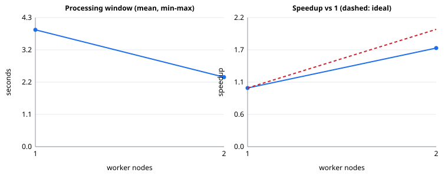
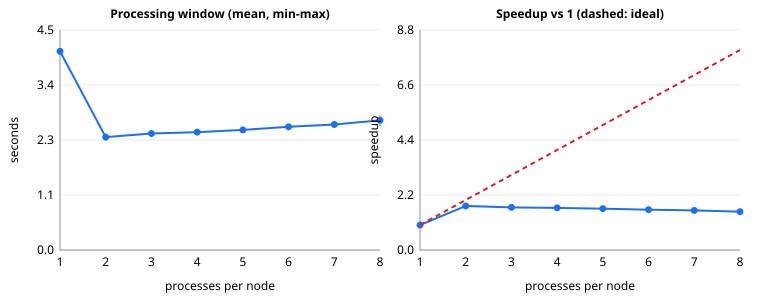

# Parallel OCR Pipeline

This project extends a single-machine OCR pipeline (CSC611M MP1) into a distributed pipeline (MP2). The master owns the image queue and sends images to worker processes over Pyro5. Each process requests one image, preprocesses it, runs Tesseract, and returns its result. The master writes the results to a CSV.

The master tracks assignments and reassigns unfinished work after a deadline. Each image appears once in a successful output. Workers use separate filesystems and do not need access to the master's dataset. See [recovery and shutdown](docs/master-recovery.md) for the failure policy.

## How it works

```text
                         Pyro5 over the network
Master                   <-------------------->  Worker node 1: OCR processes
  image dataset          <-------------------->  Worker node 2: OCR processes
  task queue and results
         |
         v
  ocr_results.csv
```

Each worker process requests one image at a time. The master sends the image and records the assignment; the worker returns the recognized text and its processing time. A lock protects the master's shared task and result state as concurrent requests arrive. If an assignment expires after 90 seconds, the master requeues the image and rejects a late result from the old assignment. After all work finishes, the master signals workers to stop and publishes the CSV. The [RPC contract](docs/pyro5-rpc-contract.md) and [recovery guide](docs/master-recovery.md) explain the protocol and failure handling.

## Requirements

- [uv](https://docs.astral.sh/uv/getting-started/installation/) and [just](https://just.systems/man/en/packages.html). uv installs the project's Python 3.15 environment from `uv.lock`.
- [Tesseract OCR](https://tesseract-ocr.github.io/tessdoc/Installation.html) on each worker, available on `PATH`.
- The course-provided image archive and English Tesseract model. See [local assets](local-assets/README.md) for their locations. These files are not included in the repository.

The team ran the native MP2 commands on Linux and Windows. The commands below use `just`. For Windows-specific installation and troubleshooting, see [Windows setup](docs/setup-windows.md).

## Prepare the project

1. Install uv and just on each node. Install Tesseract on each worker.
2. Place the supplied archive on the master. Place the model on each worker. See [local assets](local-assets/README.md) for the paths.
3. From the repository root on each node, install dependencies:

   ```text
   uv sync --locked --all-groups
   ```

4. From the repository root on the master, prepare the dataset:

   ```text
   just prepare-assets
   ```

Each worker needs its own copy of `local-assets/models/eng.traineddata`. Run the commands from the repository root. `just check-environment` checks a machine with all course assets and Tesseract. It reports missing dataset files on a worker-only node.

## Run the distributed pipeline

1. Copy `master_config.example.txt` to `master_config.txt` on the master.
2. Set `image_dir` to the master's image directory and `port` to the listening port.
3. Copy `worker_config.example.txt` to `worker_config.txt` on each worker node.
4. Set `master_host` and `master_port` to the master's reachable address and port. Use `127.0.0.1` only for processes on the same machine.
5. Set `n_workers` to the number of child processes on that worker node.
6. Start the master, then start each worker in a separate terminal or machine:

   ```text
   just master
   just worker
   ```

The master exits if no worker connects within 60 seconds, so start a worker promptly.

Use at least two separate worker machines, virtual machines, or containers for the MP2 topology. For a local deployment, see [Docker Compose setup](docs/setup-containers.md). The school-cloud deployment used native processes in three LXC containers. Its setup is in [cloud containers](docs/cloud-containers.md).

The master writes `ocr_results.csv` beside its configuration file after all images succeed. On failure, it writes partial results and diagnostics. It preserves any previous complete CSV as `ocr_results.previous.csv`. See [recovery and shutdown](docs/master-recovery.md) for output and shutdown details.

The CSV contains `image_id`, `filename`, `text`, and `processing_time_ms` for each image.

## Results at a glance

In the school-cloud experiment, one master and up to two worker nodes ran in separate LXC containers, with 2 vCPUs per node. Each setting was measured five times on the same 100 images.



With two processes per worker node, the mean processing window fell from 3.912 seconds on one worker node to 2.327 seconds on two: a 1.681× speedup and 0.841 efficiency. The dashed line shows ideal linear speedup. The timing window runs from the master's first assignment through its completion log; it excludes startup and part of shutdown. The broader elapsed-time comparison and its limitations are in [benchmark results](docs/benchmark-results.md#mp2-cloud-benchmark-ticket-44).



The best measured cloud setting was two worker nodes with two processes each. More processes shared each node's two vCPUs and did not improve the measured window. This result applies to the tested configurations and environment.

In a separate stopped-worker test, the master reassigned an expired image and produced 100 unique output rows. The same dataset achieved 0.9964 character accuracy, above the handout's 0.5 target. See [cluster acceptance](docs/cluster-acceptance.md) for the recorded test and [benchmark results](docs/benchmark-results.md#fault-injection-hard-killed-worker-node) for the cloud fault run.

## Evidence and documentation

- [MP2 requirements](docs/requirements-mp2.md) summarize the course handout.
- [RPC contract](docs/pyro5-rpc-contract.md) describes communication, assignment, and result handling.
- [Recovery and shutdown](docs/master-recovery.md) explains synchronization and failure handling.
- [Cluster acceptance](docs/cluster-acceptance.md) records a stopped-worker run and OCR accuracy.
- [Benchmark results](docs/benchmark-results.md) report the local and cloud measurements, timing boundaries, and limits.
- [OCR evaluation](docs/ocr-evaluation.md) explains preprocessing and recognition scoring.

To score a complete CSV against the supplied labels, run `just evaluate-pipeline path/to/ocr_results.csv`.

## MP1 and development

The original single-machine pipeline remains available. Set `image_dir` and `n_workers` in `config.txt`, then run `just pipeline`. See [Windows setup](docs/setup-windows.md) and the [MP1 requirements](docs/requirements.md) for more details.

Run `just --list` for available commands. Run `just verify` for the source checks and tests. See [benchmark results](docs/benchmark-results.md) for the separate MP1, MP2 local, and MP2 cloud results.

## AI declaration

The developers used Claude Code and Codex to assist with specifications, code, debugging, and tests. Bunyi and Umali made the project's key decisions, guided development, and reviewed and validated the work. They retain responsibility for the project and any errors.
