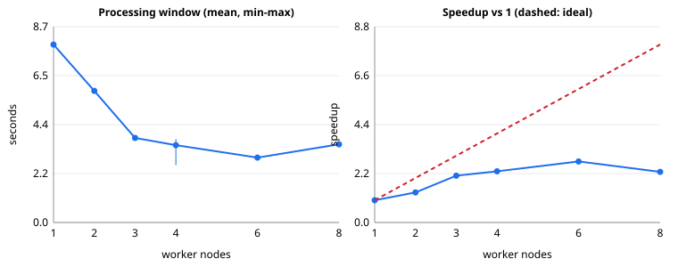
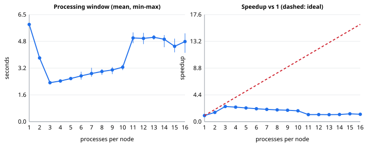
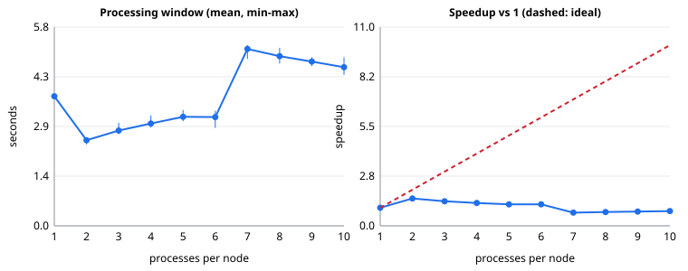

# Ticket #7 benchmark results

**Status:** MP2 cluster results are in [the MP2 section](#mp2-cluster-benchmark-ticket-27) below. MP1: The expanded linear sweep, results table, and visualization are recorded. The repository config uses the lowest-median result (11 workers) on this host. A source-only archive is prepared separately; course assets remain local as specified.

## Benchmark method

- Compare every Python worker count from 1 through 32 using the same 100 prepared images and supplied English `eng.traineddata` model (SHA-256 `7d4322bd2a7749724879683fc3912cb542f19906c83bcc1a52132556427170b2`).
- Run one warm-up per worker count, followed by ten measured runs per count in interleaved order: 352 successful full-pipeline runs in total.
- Set `OMP_THREAD_LIMIT=1` in every benchmark subprocess, so each Tesseract process uses one native OCR thread and the worker count controls Python-level concurrency.
- Keep the dataset, model, preprocessing, 30-second per-attempt OCR timeout, retry policy, and timing boundaries constant.
- Require every run to succeed and produce 100 rows with 100 unique image IDs. All warm-ups and measurements succeeded; there were no loader or recognizer retries.
- Measure from immediately before thread startup through loading, retry attempts, queue coordination, OCR, output locking, thread joins, stream close, and result publication. Configuration parsing and image enumeration happen before timing.
- Report the median and min–max range of the ten full-run durations. Speedup is the one-worker median divided by the corresponding median.

## Machine and software

| Item | Value |
|---|---|
| Run date | November 6, 2026 |
| Operating system | Windows 11 Pro, build 26300 |
| CPU | AMD Ryzen 5 5600X; 6 physical cores / 12 logical processors |
| Available memory before the sweep | 6.36 GiB |
| Python | 3.15.0 |
| Pillow | 12.3.0 |
| pytesseract | 0.3.13 |
| Tesseract | 5.4.0.20240606 |
| Dataset and model | 100 prepared images; supplied English model |
| Native OCR thread limit | `OMP_THREAD_LIMIT=1` in every benchmark subprocess |

## Results

The plot shows median runtime and speedup for all 32 tested worker counts; whiskers show the observed min–max range across ten measured runs. The horizontal axis is linear. The lowest median among tested configurations was 11 workers at 2.260 seconds (4.949× relative to one worker). The measurements flatten around 9–20 workers, with overlapping ranges, so 11 is the lowest observed median rather than a precisely isolated optimum. Runtime increases slightly beyond that plateau.

| Workers | Median (s) | Range (s) | Speedup |
|---:|---:|---:|---:|
| 1 | 11.188 | 10.834–11.488 | 1.000× |
| 2 | 5.905 | 5.588–6.199 | 1.895× |
| 3 | 4.296 | 3.951–4.440 | 2.605× |
| 4 | 3.506 | 3.128–3.790 | 3.192× |
| 5 | 3.063 | 2.789–4.134 | 3.652× |
| 6 | 2.772 | 2.499–3.071 | 4.037× |
| 7 | 2.567 | 2.376–2.955 | 4.358× |
| 8 | 2.441 | 2.247–2.732 | 4.583× |
| 9 | 2.369 | 2.255–2.549 | 4.723× |
| 10 | 2.273 | 2.121–2.490 | 4.921× |
| **11** | **2.260** | **2.118–2.473** | **4.949×** |
| 12 | 2.313 | 2.108–2.481 | 4.837× |
| 13 | 2.295 | 2.106–2.637 | 4.876× |
| 14 | 2.327 | 2.182–2.737 | 4.808× |
| 15 | 2.312 | 2.138–2.547 | 4.838× |
| 16 | 2.319 | 2.122–2.643 | 4.826× |
| 17 | 2.311 | 2.121–2.636 | 4.840× |
| 18 | 2.349 | 2.241–2.870 | 4.762× |
| 19 | 2.362 | 2.204–2.542 | 4.738× |
| 20 | 2.345 | 2.237–2.484 | 4.770× |
| 21 | 2.424 | 2.136–2.506 | 4.616× |
| 22 | 2.421 | 2.243–2.604 | 4.621× |
| 23 | 2.375 | 2.201–2.729 | 4.710× |
| 24 | 2.470 | 2.301–2.691 | 4.530× |
| 25 | 2.409 | 2.295–2.541 | 4.645× |
| 26 | 2.474 | 2.311–2.640 | 4.521× |
| 27 | 2.420 | 2.244–2.531 | 4.623× |
| 28 | 2.445 | 2.303–2.548 | 4.576× |
| 29 | 2.480 | 2.402–2.616 | 4.511× |
| 30 | 2.507 | 2.365–2.574 | 4.463× |
| 31 | 2.471 | 2.365–2.685 | 4.528× |
| 32 | 2.486 | 2.296–2.554 | 4.501× |

The linear sweep locates the useful range more clearly than the earlier 1/2/4 comparison. On this 6-core/12-logical-processor machine and this 100-image workload, adding workers helps substantially through roughly 10–11 workers. Beyond that, measured medians stay near 2.3–2.5 seconds and the extra workers do not improve throughput. This is a result for this workload and host, not a universal worker-count recommendation.

## Recognition quality and submission artifacts

The recognizer's separate quality evaluation scored 0.9952 character accuracy (99.52%), with 96 exact matches and no recognition failures. The earlier integrated-validation CSVs from 1 and 4 workers received the same score; the linear throughput sweep validates complete 100-row output but does not rescore each run's CSV.

The submission candidate CSV and its historical validation details remain documented in [`integrated-validation.md`](integrated-validation.md) and the local ignored `results/` directory. The source archive has deliberately not been assembled. Coursework submission remains a human action.

# MP2 cluster benchmark (ticket #27)

**Scope:** Local container evidence from one laptop. It shows how the Compose cluster behaves when every container shares the same 8 logical CPUs; it is **not** a multi-machine scaling measurement. The school-cloud VM data (one active worker VM versus two, and the processes-per-node sweeps on both) is a separate, later dataset and is never merged into these tables.

## MP2 benchmark method

- Run on the Ubuntu IdeaPad (`qu1r0ra-ideapad-ubuntu`) at commit `4dd29ad` in a single session, one master and `worker` replicas started by `docker compose up`. Each sample builds a fresh cluster (`down -v`, `create --scale`, copy the supplied model into each worker, `up`), so no state carries between samples.
- **Node sweep:** 1 to 16 worker nodes at 1 process per node, a linear sweep like MP1's. The master is not counted in `n`.
- **Processes-per-node sweeps:** 1 to 16 processes per node on 1 and 2 worker nodes, and 1 to 10 on 3 worker nodes. The master admits at most 32 active worker processes cluster-wide (`MAX_ACTIVE_WORKERS`), so 3 nodes × 11 to 16 processes is not a measurement. The runner skips such settings and does not run them.
- **Repetitions:** 5 per setting, interleaved within each repetition so host drift reaches every setting.
- **Validation:** a sample counts only if the master and all workers exit 0, the CSV has exactly one row per image with unique filenames, the master logged exactly one assignment per image, and `evaluate-pipeline` passes. 290 samples ran and all 290 are valid (`invalid_samples` = 0).
- **Constant:** the same 100 images and supplied `eng.traineddata`, `OMP_THREAD_LIMIT=1` (set in the image), the 90 s assignment deadline, and no fault injection. Fault injection is evidenced separately in [cluster acceptance](cluster-acceptance.md).
- **Timing boundaries**, both reported:
  - **Window** (`window_s`): the master's first `ASSIGN` log timestamp to its `Completed` log timestamp, read with `docker compose logs -t`. This is processing time and the basis of S and E.
  - **Total** (`total_s`): `docker compose up -d` issued until the master container exits. It adds container and process startup (about 6.5 s here) and so compresses every ratio.
- Metrics: `S = T1 / Tn` and `E = S / n`, with `T` the mean window. In the process sweeps, `T1` is the 1 process-per-node setting, `n` is processes per node, and S is relative to that setting on the same node count.
- Reproduce with `just benchmark-cluster` on the container host, then `just plot-benchmark <summary.json>`.

## MP2 machine and software

| Item | Value |
|---|---|
| Host | IdeaPad laptop, Ubuntu 26.04.1 (Linux 7.0.0-43), on AC power, CPU governor `powersave` |
| CPU | 11th Gen Intel(R) Core(TM) i7-1165G7 @ 2.80GHz; 4 cores / 8 logical processors |
| Memory | 14 GiB total |
| Container resources | None set: `compose.yaml` has no CPU or memory limits, so all containers and the Docker daemon share the same 8 logical CPUs |
| Docker / Compose | 29.10.0 / 5.8.0 |
| Tesseract | 5.5.0 |
| Topology | 1 master plus N worker containers on the default Compose network; communication only over Pyro5 |
| Dataset and model | 100 prepared images; supplied English model |

## MP2 results

### Worker-node sweep (1 process per node)

| Worker nodes | Runs | Window mean (s) | Stdev (s) | Range (s) | Speedup S | Efficiency E | Total mean (s) |
|---:|---:|---:|---:|---:|---:|---:|---:|
| 1 | 5 | 7.396 | 0.096 | 7.239–7.502 | 1.000× | 1.000 | 14.01 |
| 2 | 5 | 4.191 | 0.085 | 4.062–4.268 | 1.765× | 0.882 | 10.89 |
| 3 | 5 | 3.086 | 0.018 | 3.068–3.109 | 2.396× | 0.799 | 9.89 |
| 4 | 5 | 2.673 | 0.089 | 2.539–2.766 | 2.767× | 0.692 | 9.55 |
| 5 | 5 | 2.682 | 0.093 | 2.523–2.759 | 2.757× | 0.551 | 9.68 |
| 6 | 5 | 2.692 | 0.104 | 2.511–2.764 | 2.747× | 0.458 | 9.79 |
| 7 | 5 | 2.843 | 0.067 | 2.784–2.942 | 2.601× | 0.372 | 9.93 |
| 8 | 5 | 3.054 | 0.080 | 2.942–3.134 | 2.422× | 0.303 | 10.17 |
| 9 | 5 | 3.291 | 0.084 | 3.149–3.366 | 2.247× | 0.250 | 10.47 |
| 10 | 5 | 3.563 | 0.057 | 3.467–3.614 | 2.076× | 0.208 | 10.81 |
| 11 | 5 | 3.952 | 0.117 | 3.762–4.075 | 1.871× | 0.170 | 11.21 |
| 12 | 5 | 4.237 | 0.078 | 4.182–4.359 | 1.746× | 0.145 | 11.43 |
| 13 | 5 | 4.397 | 0.114 | 4.264–4.532 | 1.682× | 0.129 | 11.77 |
| 14 | 5 | 4.604 | 0.068 | 4.517–4.687 | 1.606× | 0.115 | 11.92 |
| 15 | 5 | 4.864 | 0.119 | 4.715–5.022 | 1.520× | 0.101 | 12.23 |
| 16 | 5 | 5.061 | 0.060 | 4.989–5.143 | 1.461× | 0.091 | 12.45 |

### Processes-per-node sweep (1 worker node)

| Processes per node | Runs | Window mean (s) | Stdev (s) | Range (s) | Speedup S | Efficiency E | Total mean (s) |
|---:|---:|---:|---:|---:|---:|---:|---:|
| 1 | 5 | 7.441 | 0.052 | 7.395–7.509 | 1.000× | 1.000 | 14.09 |
| 2 | 5 | 4.190 | 0.011 | 4.174–4.203 | 1.776× | 0.888 | 10.83 |
| 3 | 5 | 3.011 | 0.001 | 3.009–3.012 | 2.471× | 0.824 | 9.67 |
| 4 | 5 | 2.486 | 0.071 | 2.381–2.578 | 2.993× | 0.748 | 9.15 |
| 5 | 5 | 2.455 | 0.041 | 2.382–2.478 | 3.031× | 0.606 | 9.13 |
| 6 | 5 | 2.400 | 0.046 | 2.377–2.482 | 3.101× | 0.517 | 9.08 |
| 7 | 5 | 2.252 | 0.046 | 2.184–2.289 | 3.304× | 0.472 | 9.06 |
| 8 | 5 | 2.088 | 0.059 | 2.036–2.158 | 3.563× | 0.445 | 8.95 |
| 9 | 5 | 2.215 | 0.044 | 2.164–2.275 | 3.359× | 0.373 | 9.19 |
| 10 | 5 | 2.267 | 0.058 | 2.185–2.348 | 3.282× | 0.328 | 9.30 |
| 11 | 5 | 2.308 | 0.086 | 2.199–2.424 | 3.224× | 0.293 | 9.38 |
| 12 | 5 | 2.506 | 0.076 | 2.410–2.603 | 2.969× | 0.247 | 9.51 |
| 13 | 5 | 2.575 | 0.072 | 2.502–2.677 | 2.890× | 0.222 | 9.62 |
| 14 | 5 | 2.646 | 0.081 | 2.528–2.748 | 2.813× | 0.201 | 9.82 |
| 15 | 5 | 2.743 | 0.087 | 2.656–2.870 | 2.712× | 0.181 | 9.93 |
| 16 | 5 | 2.784 | 0.078 | 2.655–2.836 | 2.673× | 0.167 | 10.03 |

### Processes-per-node sweep (2 worker nodes)

| Processes per node | Runs | Window mean (s) | Stdev (s) | Range (s) | Speedup S | Efficiency E | Total mean (s) |
|---:|---:|---:|---:|---:|---:|---:|---:|
| 1 | 5 | 4.213 | 0.052 | 4.144–4.259 | 1.000× | 1.000 | 10.90 |
| 2 | 5 | 2.538 | 0.055 | 2.469–2.589 | 1.660× | 0.830 | 9.27 |
| 3 | 5 | 2.350 | 0.013 | 2.334–2.365 | 1.793× | 0.598 | 9.18 |
| 4 | 5 | 2.172 | 0.065 | 2.118–2.277 | 1.940× | 0.485 | 9.18 |
| 5 | 5 | 2.395 | 0.078 | 2.319–2.524 | 1.759× | 0.352 | 9.38 |
| 6 | 5 | 2.531 | 0.115 | 2.355–2.662 | 1.664× | 0.277 | 9.65 |
| 7 | 5 | 2.697 | 0.093 | 2.576–2.826 | 1.562× | 0.223 | 9.92 |
| 8 | 5 | 2.948 | 0.215 | 2.691–3.213 | 1.429× | 0.179 | 10.17 |
| 9 | 5 | 3.018 | 0.090 | 2.916–3.109 | 1.396× | 0.155 | 10.43 |
| 10 | 5 | 3.101 | 0.131 | 2.925–3.229 | 1.359× | 0.136 | 10.72 |
| 11 | 5 | 3.428 | 0.335 | 2.928–3.778 | 1.229× | 0.112 | 10.99 |
| 12 | 5 | 3.571 | 0.202 | 3.379–3.868 | 1.180× | 0.098 | 11.24 |
| 13 | 5 | 3.589 | 0.332 | 3.238–4.057 | 1.174× | 0.090 | 11.46 |
| 14 | 5 | 3.822 | 0.289 | 3.487–4.189 | 1.102× | 0.079 | 11.68 |
| 15 | 5 | 3.953 | 0.318 | 3.535–4.266 | 1.066× | 0.071 | 11.97 |
| 16 | 5 | 4.316 | 0.309 | 3.986–4.705 | 0.976× | 0.061 | 12.21 |

### Processes-per-node sweep (3 worker nodes)

| Processes per node | Runs | Window mean (s) | Stdev (s) | Range (s) | Speedup S | Efficiency E | Total mean (s) |
|---:|---:|---:|---:|---:|---:|---:|---:|
| 1 | 5 | 3.141 | 0.071 | 3.067–3.224 | 1.000× | 1.000 | 9.95 |
| 2 | 5 | 2.481 | 0.146 | 2.295–2.660 | 1.266× | 0.633 | 9.37 |
| 3 | 5 | 2.398 | 0.031 | 2.351–2.437 | 1.310× | 0.437 | 9.32 |
| 4 | 5 | 2.604 | 0.099 | 2.442–2.705 | 1.206× | 0.302 | 9.81 |
| 5 | 5 | 2.835 | 0.183 | 2.625–3.112 | 1.108× | 0.222 | 10.21 |
| 6 | 5 | 3.048 | 0.200 | 2.800–3.318 | 1.031× | 0.172 | 10.57 |
| 7 | 5 | 3.466 | 0.250 | 3.113–3.714 | 0.906× | 0.129 | 11.03 |
| 8 | 5 | 3.668 | 0.201 | 3.494–3.983 | 0.856× | 0.107 | 11.36 |
| 9 | 5 | 3.960 | 0.286 | 3.607–4.334 | 0.793× | 0.088 | 11.76 |
| 10 | 5 | 3.891 | 0.137 | 3.657–4.009 | 0.807× | 0.081 | 12.07 |

## MP2 analysis

- **Best measured configuration: 1 worker node × 8 processes**, a 2.088 s mean window (stdev 0.059 s), S = 3.56 against 1 process. The next best are 1 node × 9 processes (2.215 s), 2 nodes × 4 processes (2.172 s) and 3 nodes × 3 processes (2.398 s); the node sweep's best, 4 to 6 nodes × 1 process, is 2.67 to 2.69 s. This is the best of the measured settings, not an exhaustive search.
- **Processes beat nodes on one host.** One node × 8 processes (8 workers) is faster than 8 nodes × 1 process (3.054 s). Additional nodes add containers, RPC clients, and Pyro5 daemons that share the same 8 logical CPUs; the measurements do not isolate their individual costs. The optimum of every sweep sits at 4 to 9 total processes (4 to 6 nodes, 8 on one node, 4 per node on two nodes, 3 per node on three nodes), at or just above the 8 logical CPUs, and the window rises past it.
- **Past the optimum, the window rises.** In the node sweep the window is lowest at 4 to 6 nodes (2.67 to 2.69 s, S = 2.75 to 2.77, indistinguishable at five repetitions) and rises after. Efficiency falls steadily (E = 0.88 at 2 nodes, 0.21 at 10); added nodes share CPUs rather than adding machines. These numbers bound the overhead of the design on a shared host, not the speedup separate machines would see.
- **The ~2 s step was the master's request-loop poll, fixed in `4dd29ad`.** An earlier sweep (commit `35f2cc9`) showed the window jumping by about 2 s at 10 to 11 nodes, at 2 nodes × 10 to 11 processes, and at 3 nodes × 6 to 7 processes. Pyro5's threaded server re-checks the master's shutdown condition only when its `POLLTIMEOUT` select returns (2.0 s by default), and workers hold persistent connections, so nothing wakes it earlier; after the last result the master waited out the rest of the tick before it printed `Completed`. An isolated Pyro5 test reproduced the delay (up to 1.7 s at 2.0 s, at most 0.11 s at 0.1 s), and a probe of 2 nodes × 10 to 12 processes with a 0.1 s poll cut the 11-process mean window from 5.01 to 3.44 s. Handoff overhead (median 5 ms) and OCR time were ruled out. The master now polls every 0.1 s (`MASTER_POLL_SECONDS`), and the tables above, measured after the fix, show no step larger than 0.5 s at any of those points: 10 to 11 nodes 3.56 to 3.95 s, 2 nodes × 10 to 11 processes 3.10 to 3.43 s, 3 nodes × 6 to 7 processes 3.05 to 3.47 s.
- **Not explained:** the pre-fix window at 10 processes on 2 nodes already sat below the full 2 s tick, so the poll alone does not account for every earlier point; the fix removed the steps, so the question has no remaining effect on the tables.
- **Dispersion:** stdev is under 0.12 s for every node-sweep setting and for 1 node up to 16 processes (at most 0.087 s). It is larger on 2 and 3 nodes past about 6 processes, up to 0.335 s at 2 nodes × 11 processes. All valid samples are kept.
- **Total versus window:** totals include cluster startup and shutdown outside the window; these costs vary with configuration, so total-time speedups differ from window speedups.

## MP2 limits

- One physical laptop: no network latency, no separate memory, and no hardware isolation between nodes. Conclusions about node count do not transfer to separate VMs.
- 8 logical CPUs (4 physical cores with hyper-threading). Settings above 8 total processes oversubscribe the CPUs; the 16-process and 16-node ends measure contention, not capacity.
- **Skipped by design:** 3 nodes × 11 to 16 processes exceed the master's 32 active-process cap, so they are not run. All 290 samples that ran are valid, in one session at one commit.
- **Window definition:** the window ends at the master's `Completed` log line, so it includes `write_outputs()` and `daemon.close()` (the latter joins its pool threads). About 0.3 s of that tail remains after the poll fix; it is documented, not removed, and is not attributed to one cause.
- No container CPU limits, so results reflect default Compose behaviour; CPU limits are a possible follow-up.
- The `powersave` governor and thermal state were not controlled; interleaving spreads their effect across settings.
- Five repetitions per setting; differences under about one standard deviation, such as the node sweep's 4, 5 and 6 nodes, are not distinguishable.
- Cloud VMs will add network latency and real CPUs per node, so the cloud tables will be a separate dataset.

The dataset and model remain local course inputs; their hashes were not recorded for this run, limiting exact independent replication. The [summary and per-sample records](benchmark-cluster/benchmark-v4-summary.json) preserve the evidence used for the tables above.
