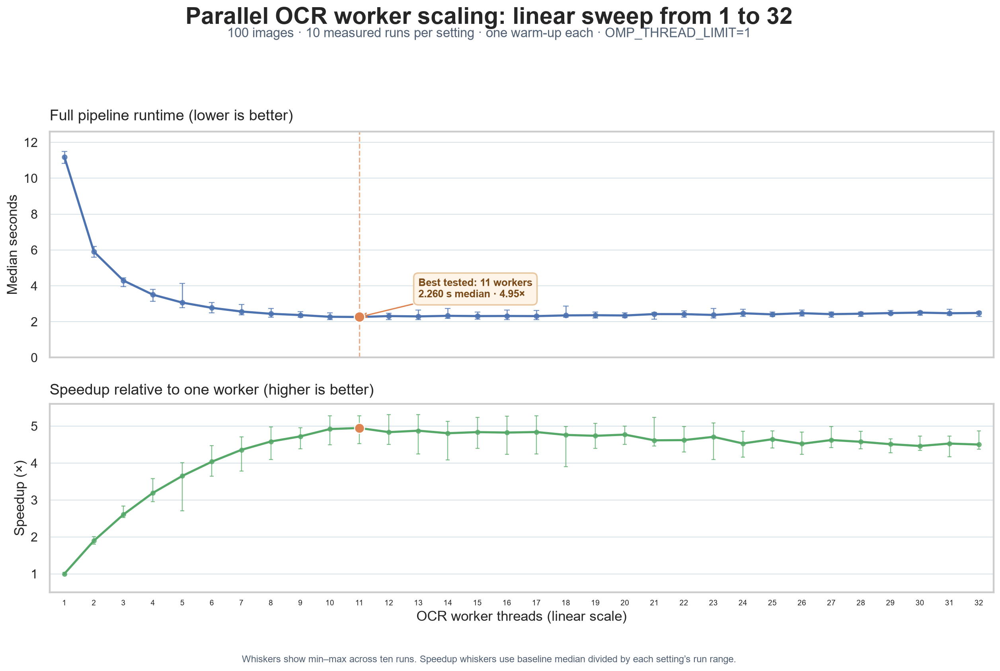
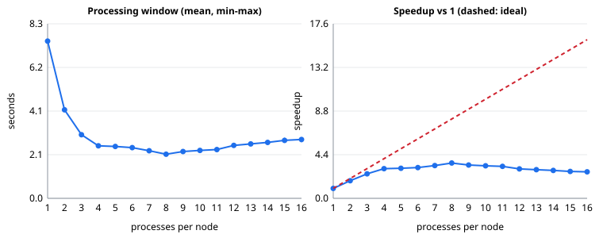

# Ticket #7 benchmark results

**Status:** MP2 cluster results are in [the MP2 section](#mp2-cluster-benchmark-ticket-27) below. MP1: The expanded linear sweep, results table, and visualization are recorded. The repository config uses the lowest-median result (11 workers) on this host. A source-only archive is prepared separately; course assets remain local as specified.

## Benchmark method

- Compare every Python worker count from 1 through 32 using the same 100 prepared images and supplied English `eng.traineddata` model (SHA-256 `7d4322bd2a7749724879683fc3912cb542f19906c83bcc1a52132556427170b2`).
- Run one warm-up per worker count, followed by ten measured runs per count in interleaved order: 352 successful full-pipeline runs in total.
- Set `OMP_THREAD_LIMIT=1` in every benchmark subprocess, so each Tesseract process uses one native OCR thread and the worker count controls Python-level concurrency.
- Keep the dataset, model, preprocessing, 30-second per-attempt OCR timeout, retry policy, and timing boundaries constant.
- Require every run to succeed and produce 100 rows with 100 unique image IDs. All warm-ups and measurements succeeded; there were no loader or recognizer retries.
- Measure from immediately before thread startup through loading, retry attempts, queue coordination, OCR, output locking, thread joins, stream close, and result publication. Configuration parsing and image enumeration happen before timing.
- Report the median and min–max range of the ten full-run durations. Speedup is the one-worker median divided by the corresponding median.

## Machine and software

| Item | Value |
|---|---|
| Run date | November 6, 2026 |
| Operating system | Windows 11 Pro, build 26300 |
| CPU | AMD Ryzen 5 5600X; 6 physical cores / 12 logical processors |
| Available memory before the sweep | 6.36 GiB |
| Python | 3.15.0 |
| Pillow | 12.3.0 |
| pytesseract | 0.3.13 |
| Tesseract | 5.4.0.20240606 |
| Dataset and model | 100 prepared images; supplied English model |
| Native OCR thread limit | `OMP_THREAD_LIMIT=1` in every benchmark subprocess |

## Results

The plot shows median runtime and speedup for all 32 tested worker counts; whiskers show the observed min–max range across ten measured runs. The horizontal axis is linear. The lowest median among tested configurations was 11 workers at 2.260 seconds (4.949× relative to one worker). The measurements flatten around 9–20 workers, with overlapping ranges, so 11 is the lowest observed median rather than a precisely isolated optimum. Runtime increases slightly beyond that plateau.

| Workers | Median (s) | Range (s) | Speedup |
|---:|---:|---:|---:|
| 1 | 11.188 | 10.834–11.488 | 1.000× |
| 2 | 5.905 | 5.588–6.199 | 1.895× |
| 3 | 4.296 | 3.951–4.440 | 2.605× |
| 4 | 3.506 | 3.128–3.790 | 3.192× |
| 5 | 3.063 | 2.789–4.134 | 3.652× |
| 6 | 2.772 | 2.499–3.071 | 4.037× |
| 7 | 2.567 | 2.376–2.955 | 4.358× |
| 8 | 2.441 | 2.247–2.732 | 4.583× |
| 9 | 2.369 | 2.255–2.549 | 4.723× |
| 10 | 2.273 | 2.121–2.490 | 4.921× |
| **11** | **2.260** | **2.118–2.473** | **4.949×** |
| 12 | 2.313 | 2.108–2.481 | 4.837× |
| 13 | 2.295 | 2.106–2.637 | 4.876× |
| 14 | 2.327 | 2.182–2.737 | 4.808× |
| 15 | 2.312 | 2.138–2.547 | 4.838× |
| 16 | 2.319 | 2.122–2.643 | 4.826× |
| 17 | 2.311 | 2.121–2.636 | 4.840× |
| 18 | 2.349 | 2.241–2.870 | 4.762× |
| 19 | 2.362 | 2.204–2.542 | 4.738× |
| 20 | 2.345 | 2.237–2.484 | 4.770× |
| 21 | 2.424 | 2.136–2.506 | 4.616× |
| 22 | 2.421 | 2.243–2.604 | 4.621× |
| 23 | 2.375 | 2.201–2.729 | 4.710× |
| 24 | 2.470 | 2.301–2.691 | 4.530× |
| 25 | 2.409 | 2.295–2.541 | 4.645× |
| 26 | 2.474 | 2.311–2.640 | 4.521× |
| 27 | 2.420 | 2.244–2.531 | 4.623× |
| 28 | 2.445 | 2.303–2.548 | 4.576× |
| 29 | 2.480 | 2.402–2.616 | 4.511× |
| 30 | 2.507 | 2.365–2.574 | 4.463× |
| 31 | 2.471 | 2.365–2.685 | 4.528× |
| 32 | 2.486 | 2.296–2.554 | 4.501× |

The linear sweep locates the useful range more clearly than the earlier 1/2/4 comparison. On this 6-core/12-logical-processor machine and this 100-image workload, adding workers helps substantially through roughly 10–11 workers. Beyond that, measured medians stay near 2.3–2.5 seconds and the extra workers do not improve throughput. This is a result for this workload and host, not a universal worker-count recommendation.

## Recognition quality and submission artifacts

The recognizer's separate quality evaluation scored 0.9952 character accuracy (99.52%), with 96 exact matches and no recognition failures. The earlier integrated-validation CSVs from 1 and 4 workers received the same score; the linear throughput sweep validates complete 100-row output but does not rescore each run's CSV.

The submission candidate CSV and its historical validation details remain documented in [`integrated-validation.md`](integrated-validation.md) and the local ignored `results/` directory. The source archive has deliberately not been assembled. Coursework submission remains a human action.

# MP2 cluster benchmark (ticket #27)

**Scope:** Local container evidence from one laptop. It shows how the Compose cluster behaves when every container shares the same 8 logical CPUs; it is **not** a multi-machine scaling measurement. The school-cloud VM data (one active worker VM versus two, and the processes-per-node sweeps on both) is a separate, later dataset and is never merged into these tables.

## MP2 benchmark method

- Run on the Ubuntu IdeaPad (`qu1r0ra-ideapad-ubuntu`) at commit `35f2cc9`, one master and `worker` replicas started by `docker compose up`. Each sample builds a fresh cluster (`down -v`, `create --scale`, copy the supplied model into each worker, `up`), so no state carries between samples.
- **Node sweep:** 1 to 16 worker nodes at 1 process per node, a linear sweep like MP1's. The master is not counted in `n`.
- **Processes-per-node sweeps:** 1 to 16 processes per node on 1 and 2 worker nodes, and 1 to 10 on 3 worker nodes. The master admits at most 32 active worker processes cluster-wide (`MAX_ACTIVE_WORKERS`), so 3 nodes × 11 to 16 processes is rejected by design and was not a measurement (those samples are counted in `invalid_samples`).
- **Repetitions:** 5 per setting, interleaved within each repetition so host drift reaches every setting.
- **Validation:** a sample counts only if the master and all workers exit 0, the CSV has exactly one row per image with unique filenames, the master logged exactly one assignment per image, and `evaluate-pipeline` passes. 320 samples ran; `invalid_samples` = 30, all excluded from the tables (causes under Limits).
- **Constant:** the same 100 images and supplied `eng.traineddata`, `OMP_THREAD_LIMIT=1` (set in the image), the 90 s assignment deadline, and no fault injection. Fault injection is evidenced separately in [cluster acceptance](cluster-acceptance.md).
- **Timing boundaries**, both reported:
  - **Window** (`window_s`): the master's first `ASSIGN` log timestamp to its `Completed` log timestamp, read with `docker compose logs -t`. This is processing time and the basis of S and E.
  - **Total** (`total_s`): `docker compose up -d` issued until the master container exits. It adds container and process startup (about 6.5 s here) and so compresses every ratio.
- Metrics: `S = T1 / Tn` and `E = S / n`, with `T` the mean window. In the process sweeps, `T1` is the 1 process-per-node setting, `n` is processes per node, and S is relative to that setting on the same node count.
- Reproduce with `just benchmark-cluster` on the container host, then `just plot-benchmark <summary.json>`.

## MP2 machine and software

| Item | Value |
|---|---|
| Host | IdeaPad laptop, Ubuntu (Linux 7.0.0-43), on AC power, CPU governor `powersave` |
| CPU | 11th Gen Intel(R) Core(TM) i7-1165G7 @ 2.80GHz; 4 cores / 8 logical processors |
| Memory | 14 GiB total |
| Container resources | None set: `compose.yaml` has no CPU or memory limits, so all containers and the Docker daemon share the same 8 logical CPUs |
| Docker / Compose | 29.10.0 / 5.8.0 |
| Tesseract | 5.5.0 |
| Topology | 1 master plus N worker containers on the default Compose network; communication only over Pyro5 |
| Dataset and model | 100 prepared images; supplied English model |

## MP2 results

### Worker-node sweep (1 process per node)

| Worker nodes | Runs | Window mean (s) | Stdev (s) | Range (s) | Speedup S | Efficiency E | Total mean (s) |
|---:|---:|---:|---:|---:|---:|---:|---:|
| 1 | 5 | 7.939 | 0.004 | 7.935–7.944 | 1.000× | 1.000 | 14.52 |
| 2 | 5 | 5.870 | 0.012 | 5.857–5.887 | 1.352× | 0.676 | 12.53 |
| 3 | 5 | 3.740 | 0.065 | 3.648–3.829 | 2.123× | 0.708 | 10.52 |
| 4 | 5 | 3.690 | 0.040 | 3.636–3.749 | 2.152× | 0.538 | 10.53 |
| 5 | 5 | 2.697 | 0.049 | 2.659–2.773 | 2.944× | 0.589 | 9.65 |
| 6 | 5 | 2.921 | 0.043 | 2.855–2.964 | 2.718× | 0.453 | 9.93 |
| 7 | 5 | 3.228 | 0.047 | 3.179–3.292 | 2.459× | 0.351 | 10.30 |
| 8 | 5 | 3.523 | 0.048 | 3.453–3.584 | 2.253× | 0.282 | 10.53 |
| 9 | 5 | 3.536 | 0.027 | 3.489–3.556 | 2.245× | 0.249 | 10.55 |
| 10 | 5 | 3.601 | 0.024 | 3.576–3.638 | 2.205× | 0.220 | 10.68 |
| 11 | 5 | 5.668 | 0.108 | 5.563–5.822 | 1.401× | 0.127 | 12.71 |
| 12 | 5 | 4.816 | 1.055 | 3.929–6.021 | 1.648× | 0.137 | 11.99 |
| 13 | 5 | 4.737 | 0.868 | 4.190–6.271 | 1.676× | 0.129 | 11.97 |
| 14 | 5 | 4.712 | 0.118 | 4.532–4.824 | 1.685× | 0.120 | 11.90 |
| 15 | 5 | 4.686 | 0.227 | 4.354–4.910 | 1.694× | 0.113 | 11.84 |
| 16 | 5 | 5.148 | 0.193 | 4.932–5.368 | 1.542× | 0.096 | 12.23 |

Nodes 11 to 16 were rerun after the worker initial-connect retry (#38) landed, at commit `1506c4f`; all 30 of those samples are valid.

### Processes-per-node sweep (1 worker node)

| Processes per node | Runs | Window mean (s) | Stdev (s) | Range (s) | Speedup S | Efficiency E | Total mean (s) |
|---:|---:|---:|---:|---:|---:|---:|---:|
| 1 | 5 | 7.908 | 0.009 | 7.894–7.915 | 1.000× | 1.000 | 14.53 |
| 2 | 5 | 5.895 | 0.013 | 5.882–5.914 | 1.341× | 0.671 | 12.53 |
| 3 | 5 | 3.876 | 0.009 | 3.863–3.887 | 2.040× | 0.680 | 10.54 |
| 4 | 5 | 3.882 | 0.006 | 3.871–3.888 | 2.037× | 0.509 | 10.54 |
| 5 | 5 | 2.366 | 0.005 | 2.360–2.374 | 3.342× | 0.668 | 9.03 |
| 6 | 5 | 2.360 | 0.016 | 2.334–2.375 | 3.351× | 0.558 | 9.03 |
| 7 | 5 | 2.275 | 0.003 | 2.271–2.277 | 3.476× | 0.497 | 9.05 |
| 8 | 5 | 2.244 | 0.007 | 2.233–2.250 | 3.525× | 0.441 | 9.08 |
| 9 | 5 | 2.474 | 0.055 | 2.398–2.523 | 3.197× | 0.355 | 9.42 |
| 10 | 5 | 2.501 | 0.044 | 2.462–2.564 | 3.162× | 0.316 | 9.46 |
| 11 | 5 | 2.586 | 0.087 | 2.487–2.675 | 3.057× | 0.278 | 9.57 |
| 12 | 5 | 2.728 | 0.100 | 2.632–2.845 | 2.899× | 0.242 | 9.74 |
| 13 | 5 | 2.761 | 0.079 | 2.699–2.891 | 2.864× | 0.220 | 9.86 |
| 14 | 5 | 2.846 | 0.151 | 2.602–3.008 | 2.779× | 0.198 | 9.89 |
| 15 | 5 | 2.914 | 0.112 | 2.810–3.062 | 2.713× | 0.181 | 10.08 |
| 16 | 5 | 3.074 | 0.163 | 2.878–3.295 | 2.572× | 0.161 | 10.23 |

### Processes-per-node sweep (2 worker nodes)

| Processes per node | Runs | Window mean (s) | Stdev (s) | Range (s) | Speedup S | Efficiency E | Total mean (s) |
|---:|---:|---:|---:|---:|---:|---:|---:|
| 1 | 5 | 5.863 | 0.006 | 5.857–5.870 | 1.000× | 1.000 | 12.54 |
| 2 | 5 | 3.842 | 0.012 | 3.830–3.862 | 1.526× | 0.763 | 10.53 |
| 3 | 5 | 2.350 | 0.009 | 2.338–2.360 | 2.495× | 0.832 | 9.16 |
| 4 | 5 | 2.453 | 0.057 | 2.385–2.516 | 2.390× | 0.598 | 9.37 |
| 5 | 5 | 2.601 | 0.024 | 2.563–2.623 | 2.254× | 0.451 | 9.60 |
| 6 | 5 | 2.761 | 0.188 | 2.535–3.011 | 2.124× | 0.354 | 9.85 |
| 7 | 5 | 2.903 | 0.213 | 2.706–3.249 | 2.020× | 0.289 | 10.10 |
| 8 | 5 | 3.026 | 0.130 | 2.820–3.169 | 1.938× | 0.242 | 10.35 |
| 9 | 5 | 3.121 | 0.164 | 2.868–3.297 | 1.878× | 0.209 | 10.52 |
| 10 | 5 | 3.285 | 0.139 | 3.108–3.437 | 1.785× | 0.179 | 10.62 |
| 11 | 5 | 5.048 | 0.264 | 4.733–5.384 | 1.162× | 0.106 | 12.59 |
| 12 | 5 | 5.021 | 0.267 | 4.679–5.355 | 1.168× | 0.097 | 12.65 |
| 13 | 5 | 5.088 | 0.124 | 4.943–5.224 | 1.152× | 0.089 | 12.64 |
| 14 | 5 | 4.971 | 0.283 | 4.492–5.221 | 1.179× | 0.084 | 12.64 |
| 15 | 5 | 4.544 | 0.332 | 4.181–5.008 | 1.290× | 0.086 | 12.64 |
| 16 | 5 | 4.831 | 0.440 | 4.153–5.327 | 1.214× | 0.076 | 12.66 |

### Processes-per-node sweep (3 worker nodes)

| Processes per node | Runs | Window mean (s) | Stdev (s) | Range (s) | Speedup S | Efficiency E | Total mean (s) |
|---:|---:|---:|---:|---:|---:|---:|---:|
| 1 | 5 | 3.752 | 0.036 | 3.704–3.801 | 1.000× | 1.000 | 10.54 |
| 2 | 5 | 2.479 | 0.083 | 2.359–2.552 | 1.514× | 0.757 | 9.38 |
| 3 | 5 | 2.760 | 0.142 | 2.657–2.983 | 1.359× | 0.453 | 9.73 |
| 4 | 5 | 2.963 | 0.137 | 2.845–3.200 | 1.266× | 0.317 | 10.07 |
| 5 | 5 | 3.157 | 0.135 | 3.032–3.353 | 1.188× | 0.238 | 10.44 |
| 6 | 5 | 3.149 | 0.210 | 2.837–3.332 | 1.191× | 0.199 | 10.58 |
| 7 | 5 | 5.123 | 0.166 | 4.834–5.232 | 0.732× | 0.105 | 12.61 |
| 8 | 5 | 4.913 | 0.190 | 4.699–5.155 | 0.764× | 0.095 | 12.67 |
| 9 | 5 | 4.757 | 0.093 | 4.625–4.879 | 0.789× | 0.088 | 12.66 |
| 10 | 5 | 4.594 | 0.223 | 4.372–4.878 | 0.817× | 0.082 | 12.68 |

## MP2 analysis

- **Best measured configuration: 1 worker node × 8 processes**, a 2.244 s mean window (stdev 0.007 s), S = 3.53 against 1 process. Seven processes (2.275 s) and the best multi-node settings are close: 2 nodes × 3 processes 2.350 s, 3 nodes × 2 processes 2.479 s, and the node sweep's 5 nodes × 1 process 2.697 s. This is the best of the measured settings, not an exhaustive search.
- **Processes beat nodes on one host.** One node × 8 processes (8 workers) is faster than 8 nodes × 1 process (3.523 s), because every extra node adds a container, an RPC client, and a Pyro5 daemon on the same 8 logical CPUs. The optimum of every sweep sits at 5 to 8 total processes (5 nodes, 8 on one node, 6 on two and three nodes), at or below the 8 logical CPUs, and the window rises past it.
- **Past the optimum, contention dominates.** In the node sweep the window is lowest at 5 nodes (2.697 s, S = 2.94) and rises after. Efficiency falls steadily (E = 0.68 at 2 nodes, 0.22 at 10) because added nodes share CPUs rather than adding machines. These numbers bound the overhead of the design on a shared host, not the speedup separate machines would see.
- **A step the data does not explain.** The window jumps by about 2 s in three places: node sweep 10 to 11 nodes (3.60 to 5.67 s), 2 nodes × 10 to 11 processes (3.29 to 5.05 s), and 3 nodes × 6 to 7 processes (3.15 to 5.12 s). A separate rerun of 2 nodes × 10, 11, and 12 processes reproduced it (about 3.2 s, then about 5.0 s at both 11 and 12), and the total time rose by the same 2 s, so it is in processing rather than log timing. One node × 11 to 16 processes shows no step. The cause is not established. The Pyro5 thread pool, process-startup oversubscription, and master serialization were considered and not tested. The measured optima lie well below this region.
- **Not explained:** going from 1 to 2 nodes at 1 process per node gives only S = 1.35, while 2 to 3 nodes gives 1.57×.
- **Dispersion:** stdev is under 0.2 s for every setting up to about 8 total processes and rises past it, up to 1.06 s at 12 nodes and 0.87 s at 13 nodes. All valid samples are kept.
- **Total versus window:** totals include about 6.5 s of startup regardless of configuration; a total-only view would understate every speedup.

## MP2 limits

- One physical laptop: no network latency, no separate memory, and no hardware isolation between nodes. Conclusions about node count do not transfer to separate VMs.
- 8 logical CPUs (4 physical cores with hyper-threading). Settings above 8 total processes oversubscribe the CPUs; the 16-process and 16-node ends measure contention, not capacity.
- **Invalid samples (30 of 320):** the 3 nodes × 11 to 16 processes settings exceed the master's 32 active-process cap and were rejected by design. The first run of the node sweep lost samples at 13 to 16 nodes when Docker DNS failed a worker's first lookup (`Temporary failure in name resolution`) and the worker exited 1. Issue #38 added a bounded initial-connect retry, and nodes 11 to 16 were rerun with it (5 of 5 valid at every count); the tables use that rerun for 11 to 16 and the first run for 1 to 10, so those two ranges were measured in different sessions.
- No container CPU limits, so results reflect default Compose behaviour; CPU limits are a possible follow-up.
- The `powersave` governor and thermal state were not controlled; interleaving spreads their effect across settings.
- Five repetitions per setting; differences under about one standard deviation, such as 7 versus 8 processes on one node, are not distinguishable.
- Cloud VMs will add network latency and real CPUs per node, so the cloud tables will be a separate dataset.

Raw per-sample records are in the ignored `results/benchmark-v2-merged/summary.json` (v2 with the 11 to 16 node rerun from `results/benchmark-v3-nodes/summary.json`); every row of the tables above is derived from it.
