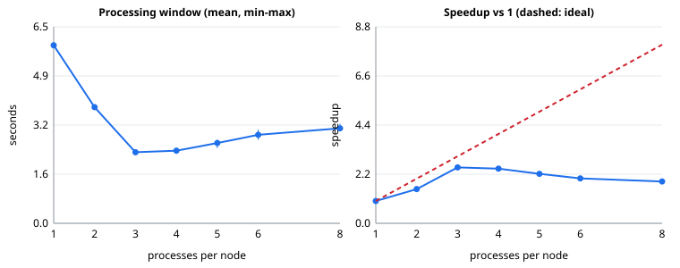

# Ticket #7 benchmark results

**Status:** MP2 cluster results are in [the MP2 section](#mp2-cluster-benchmark-ticket-27) below. MP1: The expanded linear sweep, results table, and visualization are recorded. The repository config uses the lowest-median result (11 workers) on this host. A source-only archive is prepared separately; course assets remain local as specified.

## Benchmark method

- Compare every Python worker count from 1 through 32 using the same 100 prepared images and supplied English `eng.traineddata` model (SHA-256 `7d4322bd2a7749724879683fc3912cb542f19906c83bcc1a52132556427170b2`).
- Run one warm-up per worker count, followed by ten measured runs per count in interleaved order: 352 successful full-pipeline runs in total.
- Set `OMP_THREAD_LIMIT=1` in every benchmark subprocess, so each Tesseract process uses one native OCR thread and the worker count controls Python-level concurrency.
- Keep the dataset, model, preprocessing, 30-second per-attempt OCR timeout, retry policy, and timing boundaries constant.
- Require every run to succeed and produce 100 rows with 100 unique image IDs. All warm-ups and measurements succeeded; there were no loader or recognizer retries.
- Measure from immediately before thread startup through loading, retry attempts, queue coordination, OCR, output locking, thread joins, stream close, and result publication. Configuration parsing and image enumeration happen before timing.
- Report the median and min–max range of the ten full-run durations. Speedup is the one-worker median divided by the corresponding median.

## Machine and software

| Item | Value |
|---|---|
| Run date | November 6, 2026 |
| Operating system | Windows 11 Pro, build 26300 |
| CPU | AMD Ryzen 5 5600X; 6 physical cores / 12 logical processors |
| Available memory before the sweep | 6.36 GiB |
| Python | 3.15.0 |
| Pillow | 12.3.0 |
| pytesseract | 0.3.13 |
| Tesseract | 5.4.0.20240606 |
| Dataset and model | 100 prepared images; supplied English model |
| Native OCR thread limit | `OMP_THREAD_LIMIT=1` in every benchmark subprocess |

## Results

The plot shows median runtime and speedup for all 32 tested worker counts; whiskers show the observed min–max range across ten measured runs. The horizontal axis is linear. The lowest median among tested configurations was 11 workers at 2.260 seconds (4.949× relative to one worker). The measurements flatten around 9–20 workers, with overlapping ranges, so 11 is the lowest observed median rather than a precisely isolated optimum. Runtime increases slightly beyond that plateau.

| Workers | Median (s) | Range (s) | Speedup |
|---:|---:|---:|---:|
| 1 | 11.188 | 10.834–11.488 | 1.000× |
| 2 | 5.905 | 5.588–6.199 | 1.895× |
| 3 | 4.296 | 3.951–4.440 | 2.605× |
| 4 | 3.506 | 3.128–3.790 | 3.192× |
| 5 | 3.063 | 2.789–4.134 | 3.652× |
| 6 | 2.772 | 2.499–3.071 | 4.037× |
| 7 | 2.567 | 2.376–2.955 | 4.358× |
| 8 | 2.441 | 2.247–2.732 | 4.583× |
| 9 | 2.369 | 2.255–2.549 | 4.723× |
| 10 | 2.273 | 2.121–2.490 | 4.921× |
| **11** | **2.260** | **2.118–2.473** | **4.949×** |
| 12 | 2.313 | 2.108–2.481 | 4.837× |
| 13 | 2.295 | 2.106–2.637 | 4.876× |
| 14 | 2.327 | 2.182–2.737 | 4.808× |
| 15 | 2.312 | 2.138–2.547 | 4.838× |
| 16 | 2.319 | 2.122–2.643 | 4.826× |
| 17 | 2.311 | 2.121–2.636 | 4.840× |
| 18 | 2.349 | 2.241–2.870 | 4.762× |
| 19 | 2.362 | 2.204–2.542 | 4.738× |
| 20 | 2.345 | 2.237–2.484 | 4.770× |
| 21 | 2.424 | 2.136–2.506 | 4.616× |
| 22 | 2.421 | 2.243–2.604 | 4.621× |
| 23 | 2.375 | 2.201–2.729 | 4.710× |
| 24 | 2.470 | 2.301–2.691 | 4.530× |
| 25 | 2.409 | 2.295–2.541 | 4.645× |
| 26 | 2.474 | 2.311–2.640 | 4.521× |
| 27 | 2.420 | 2.244–2.531 | 4.623× |
| 28 | 2.445 | 2.303–2.548 | 4.576× |
| 29 | 2.480 | 2.402–2.616 | 4.511× |
| 30 | 2.507 | 2.365–2.574 | 4.463× |
| 31 | 2.471 | 2.365–2.685 | 4.528× |
| 32 | 2.486 | 2.296–2.554 | 4.501× |

The linear sweep locates the useful range more clearly than the earlier 1/2/4 comparison. On this 6-core/12-logical-processor machine and this 100-image workload, adding workers helps substantially through roughly 10–11 workers. Beyond that, measured medians stay near 2.3–2.5 seconds and the extra workers do not improve throughput. This is a result for this workload and host, not a universal worker-count recommendation.

## Recognition quality and submission artifacts

The recognizer's separate quality evaluation scored 0.9952 character accuracy (99.52%), with 96 exact matches and no recognition failures. The earlier integrated-validation CSVs from 1 and 4 workers received the same score; the linear throughput sweep validates complete 100-row output but does not rescore each run's CSV.

The submission candidate CSV and its historical validation details remain documented in [`integrated-validation.md`](integrated-validation.md) and the local ignored `results/` directory. The source archive has deliberately not been assembled. Coursework submission remains a human action.

# MP2 cluster benchmark (ticket #27)

**Scope:** Local container evidence from one laptop. It shows how the Compose cluster behaves when every container shares the same 8 logical CPUs; it is **not** a multi-machine scaling measurement. The school-cloud VM comparison (one worker VM versus two, and the processes-per-node sweep on two worker VMs) is separate, later data and is not reported here.

## MP2 benchmark method

- Run on the Ubuntu IdeaPad (`qu1r0ra-ideapad-ubuntu`) at commit `ba4761d`, one master and `worker` replicas started by `docker compose up`. Each sample builds a fresh cluster (`down -v`, `create --scale`, copy the supplied model into each worker, `up`), so no state carries between samples.
- **Node sweep:** 1, 2, 3, 4, 6, and 8 worker nodes at 1 process per node. This is the matched comparison of one active worker node against several, with identical per-node settings. The master is not counted in `n`.
- **Processes-per-node sweep:** 1, 2, 3, 4, 5, 6, and 8 processes per node on a fixed two worker nodes (the course topology).
- **Repetitions:** 5 per setting, interleaved within each repetition so host drift reaches every setting. The pilot (1 repetition) showed processing windows of 2–6 s with noticeable jitter, hence five.
- **Validation:** a sample counts only if the master and all workers exit 0, the CSV has exactly one row per image with unique filenames, the master logged exactly one assignment per image, and `evaluate-pipeline` passes. All 65 samples were valid (`invalid_samples` = 0).
- **Constant:** the same 100 images and supplied `eng.traineddata`, `OMP_THREAD_LIMIT=1` (set in the image), the 90 s assignment deadline, and no fault injection. Fault injection is evidenced separately in [cluster acceptance](cluster-acceptance.md).
- **Timing boundaries**, both reported:
  - **Window** (`window_s`): the master's first `ASSIGN` log timestamp to its `Completed` log timestamp, read with `docker compose logs -t`. This is processing time and the basis of S and E.
  - **Total** (`total_s`): `docker compose up -d` issued until the master container exits. It adds container and process startup (about 6.5 s here) and so compresses every ratio.
- Metrics: `S = T1 / Tn` and `E = S / n`, with `T` the mean window. In the process sweep, `T1` is the 1 process-per-node setting and `n` is processes per node.
- Reproduce with `just benchmark-cluster` on the container host, then `just plot-benchmark <summary.json>`.

## MP2 machine and software

| Item | Value |
|---|---|
| Host | IdeaPad laptop, Ubuntu (Linux 7.0.0-43), on AC power, CPU governor `powersave` |
| CPU | 11th Gen Intel(R) Core(TM) i7-1165G7 @ 2.80GHz; 4 cores / 8 logical processors |
| Memory | 14 GiB total, about 9 GiB free before the sweep |
| Container resources | None set: `compose.yaml` has no CPU or memory limits, so all containers and the Docker daemon share the same 8 logical CPUs |
| Docker / Compose | 29.10.0 / 5.8.0 |
| Tesseract | 5.5.0 |
| Topology | 1 master plus N worker containers on the default Compose network; communication only over Pyro5 |
| Dataset and model | 100 prepared images; supplied English model |

## MP2 results

### Worker-node sweep (1 process per node)

| Worker nodes | Runs | Window mean (s) | Stdev (s) | Range (s) | Speedup S | Efficiency E | Total mean (s) |
|---:|---:|---:|---:|---:|---:|---:|---:|
| 1 | 5 | 7.926 | 0.003 | 7.923–7.929 | 1.000× | 1.000 | 14.54 |
| 2 | 5 | 5.863 | 0.005 | 5.856–5.868 | 1.352× | 0.676 | 12.54 |
| 3 | 5 | 3.767 | 0.049 | 3.718–3.821 | 2.104× | 0.701 | 10.53 |
| 4 | 5 | 3.445 | 0.499 | 2.557–3.720 | 2.301× | 0.575 | 10.32 |
| 6 | 5 | 2.891 | 0.049 | 2.844–2.964 | 2.742× | 0.457 | 9.92 |
| 8 | 5 | 3.483 | 0.079 | 3.353–3.541 | 2.276× | 0.284 | 10.54 |

### Processes-per-node sweep (2 worker nodes)

| Processes per node | Runs | Window mean (s) | Stdev (s) | Range (s) | Speedup S | Efficiency E | Total mean (s) |
|---:|---:|---:|---:|---:|---:|---:|---:|
| 1 | 5 | 5.864 | 0.014 | 5.850–5.884 | 1.000× | 1.000 | 12.53 |
| 2 | 5 | 3.826 | 0.025 | 3.783–3.845 | 1.533× | 0.766 | 10.54 |
| 3 | 5 | 2.341 | 0.023 | 2.301–2.359 | 2.505× | 0.835 | 9.13 |
| 4 | 5 | 2.393 | 0.060 | 2.320–2.483 | 2.450× | 0.613 | 9.35 |
| 5 | 5 | 2.645 | 0.109 | 2.479–2.753 | 2.217× | 0.443 | 9.61 |
| 6 | 5 | 2.915 | 0.125 | 2.750–3.084 | 2.012× | 0.335 | 9.91 |
| 8 | 5 | 3.129 | 0.090 | 3.040–3.277 | 1.874× | 0.234 | 10.32 |

## MP2 analysis

- **Best measured configuration: 2 worker nodes × 3 processes per node**, a 2.341 s mean window (stdev 0.023 s) and about 9.1 s total. Four processes per node is within noise of it (2.393 s); five or more is slower. This is the best of the 13 settings measured, not an exhaustive search of node and process combinations.
- **More nodes help up to a point.** At 1 process per node the window falls from 7.926 s (1 node) to 2.891 s (6 nodes), S = 2.74. Eight nodes (3.483 s) is slower than six: the master, the Docker daemon, and eight workers plus their Tesseract children compete for 8 logical CPUs.
- **Efficiency drops steadily** (E = 0.68 at 2 nodes, 0.46 at 6, 0.28 at 8) because the extra nodes are containers on the same CPUs rather than additional machines. Adding capacity here mostly adds contention, so these numbers bound the overhead of the design on a shared host, not the speedup separate machines would see.
- **Processes per node scale better than nodes at the same CPU count.** Two nodes × 3 processes (6 processes) reaches 2.341 s; six nodes × 1 process reaches 2.891 s. Each extra node adds a container, an RPC client, and a Pyro5 daemon; each extra process adds only an OCR worker.
- **The two sweeps agree where they overlap:** 2 nodes × 1 process measured 5.863 s in the node sweep and 5.864 s in the process sweep.
- **Not explained:** going from 1 to 2 nodes at 1 process per node gives only S = 1.35, while 2 to 3 nodes gives 1.56×. The data does not say why. Candidate causes (staggered worker startup inside the window, master `get_work` serialization) were not tested.
- **Dispersion:** stdev is under 0.13 s everywhere except 4 nodes (0.499 s, range 2.557–3.720 s), where one repetition ran about 1.2 s faster than the others. All 65 samples are kept; none was discarded.
- **Total versus window:** totals run 9.1–14.5 s because startup costs about 6.5 s regardless of configuration; a total-only view would understate every speedup.

## MP2 limits

- One physical laptop: no network latency, no separate memory, and no hardware isolation between nodes. Conclusions about node count do not transfer to separate VMs.
- 8 logical CPUs (4 physical cores with hyper-threading). The optimum sits near 6 total processes, and total process counts up to 16 (2 nodes × 8) were measured.
- No container CPU limits, so results reflect default Compose behaviour. Windows lengthen beyond about 6 total processes, so CPU limits are a possible follow-up; they were not applied.
- The `powersave` governor and thermal state were not controlled; interleaving spreads their effect across settings.
- Five repetitions per setting; the 3 versus 4 processes-per-node difference (0.05 s) is within about one standard deviation.

Raw per-sample records are in the ignored `results/benchmark-v1/summary.json`; every row of the tables above is derived from it.
