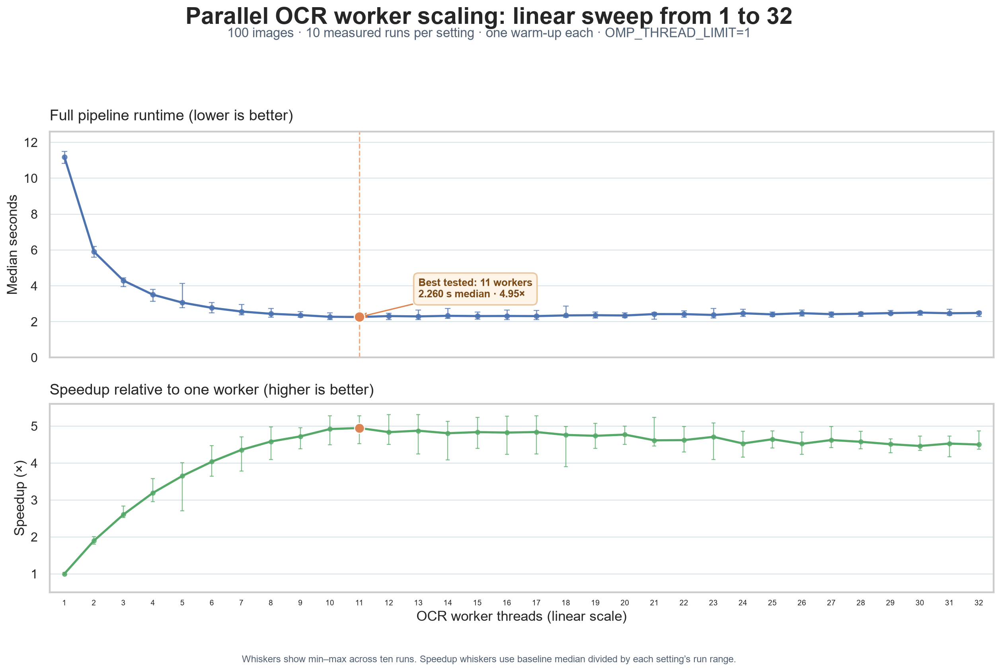

# Ticket #7 benchmark results

**Status:** The expanded linear sweep, results table, and visualization are recorded. The repository config uses the lowest-median result (11 workers) on this host. A source-only archive is prepared separately; course assets remain local as specified.

## Benchmark method

- Compare every Python worker count from 1 through 32 using the same 100 prepared images and supplied English `eng.traineddata` model (SHA-256 `7d4322bd2a7749724879683fc3912cb542f19906c83bcc1a52132556427170b2`).
- Run one warm-up per worker count, followed by ten measured runs per count in interleaved order: 352 successful full-pipeline runs in total.
- Set `OMP_THREAD_LIMIT=1` in every benchmark subprocess, so each Tesseract process uses one native OCR thread and the worker count controls Python-level concurrency.
- Keep the dataset, model, preprocessing, 30-second per-attempt OCR timeout, retry policy, and timing boundaries constant.
- Require every run to succeed and produce 100 rows with 100 unique image IDs. All warm-ups and measurements succeeded; there were no loader or recognizer retries.
- Measure from immediately before thread startup through loading, retry attempts, queue coordination, OCR, output locking, thread joins, stream close, and result publication. Configuration parsing and image enumeration happen before timing.
- Report the median and min–max range of the ten full-run durations. Speedup is the one-worker median divided by the corresponding median.

## Machine and software

| Item | Value |
|---|---|
| Run date | November 6, 2026 |
| Operating system | Windows 11 Pro, build 26300 |
| CPU | AMD Ryzen 5 5600X; 6 physical cores / 12 logical processors |
| Available memory before the sweep | 6.36 GiB |
| Python | 3.15.0 |
| Pillow | 12.3.0 |
| pytesseract | 0.3.13 |
| Tesseract | 5.4.0.20240606 |
| Dataset and model | 100 prepared images; supplied English model |
| Native OCR thread limit | `OMP_THREAD_LIMIT=1` in every benchmark subprocess |

## Results

The plot shows median runtime and speedup for all 32 tested worker counts; whiskers show the observed min–max range across ten measured runs. The horizontal axis is linear. The lowest median among tested configurations was 11 workers at 2.260 seconds (4.949× relative to one worker). The measurements flatten around 9–20 workers, with overlapping ranges, so 11 is the lowest observed median rather than a precisely isolated optimum. Runtime increases slightly beyond that plateau.

| Workers | Median (s) | Range (s) | Speedup |
|---:|---:|---:|---:|
| 1 | 11.188 | 10.834–11.488 | 1.000× |
| 2 | 5.905 | 5.588–6.199 | 1.895× |
| 3 | 4.296 | 3.951–4.440 | 2.605× |
| 4 | 3.506 | 3.128–3.790 | 3.192× |
| 5 | 3.063 | 2.789–4.134 | 3.652× |
| 6 | 2.772 | 2.499–3.071 | 4.037× |
| 7 | 2.567 | 2.376–2.955 | 4.358× |
| 8 | 2.441 | 2.247–2.732 | 4.583× |
| 9 | 2.369 | 2.255–2.549 | 4.723× |
| 10 | 2.273 | 2.121–2.490 | 4.921× |
| **11** | **2.260** | **2.118–2.473** | **4.949×** |
| 12 | 2.313 | 2.108–2.481 | 4.837× |
| 13 | 2.295 | 2.106–2.637 | 4.876× |
| 14 | 2.327 | 2.182–2.737 | 4.808× |
| 15 | 2.312 | 2.138–2.547 | 4.838× |
| 16 | 2.319 | 2.122–2.643 | 4.826× |
| 17 | 2.311 | 2.121–2.636 | 4.840× |
| 18 | 2.349 | 2.241–2.870 | 4.762× |
| 19 | 2.362 | 2.204–2.542 | 4.738× |
| 20 | 2.345 | 2.237–2.484 | 4.770× |
| 21 | 2.424 | 2.136–2.506 | 4.616× |
| 22 | 2.421 | 2.243–2.604 | 4.621× |
| 23 | 2.375 | 2.201–2.729 | 4.710× |
| 24 | 2.470 | 2.301–2.691 | 4.530× |
| 25 | 2.409 | 2.295–2.541 | 4.645× |
| 26 | 2.474 | 2.311–2.640 | 4.521× |
| 27 | 2.420 | 2.244–2.531 | 4.623× |
| 28 | 2.445 | 2.303–2.548 | 4.576× |
| 29 | 2.480 | 2.402–2.616 | 4.511× |
| 30 | 2.507 | 2.365–2.574 | 4.463× |
| 31 | 2.471 | 2.365–2.685 | 4.528× |
| 32 | 2.486 | 2.296–2.554 | 4.501× |

The linear sweep locates the useful range more clearly than the earlier 1/2/4 comparison. On this 6-core/12-logical-processor machine and this 100-image workload, adding workers helps substantially through roughly 10–11 workers. Beyond that, measured medians stay near 2.3–2.5 seconds and the extra workers do not improve throughput. This is a result for this workload and host, not a universal worker-count recommendation.

## Recognition quality and submission artifacts

The recognizer's separate quality evaluation scored 0.9952 character accuracy (99.52%), with 96 exact matches and no recognition failures. The earlier integrated-validation CSVs from 1 and 4 workers received the same score; the linear throughput sweep validates complete 100-row output but does not rescore each run's CSV.

The submission candidate CSV and its historical validation details remain documented in [`integrated-validation.md`](integrated-validation.md) and the local ignored `results/` directory. The source archive has deliberately not been assembled. Coursework submission remains a human action.
